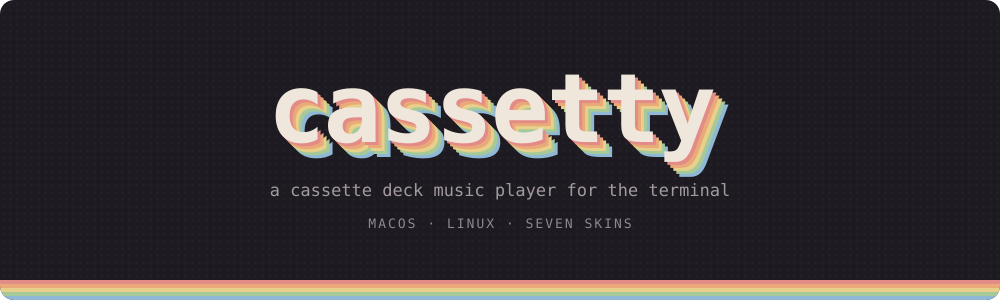
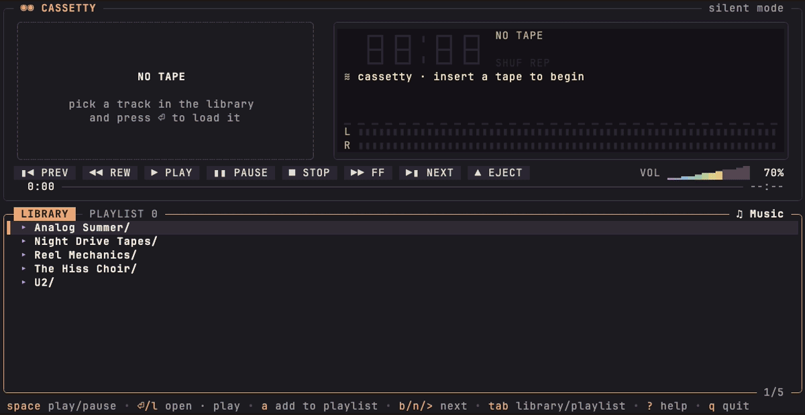
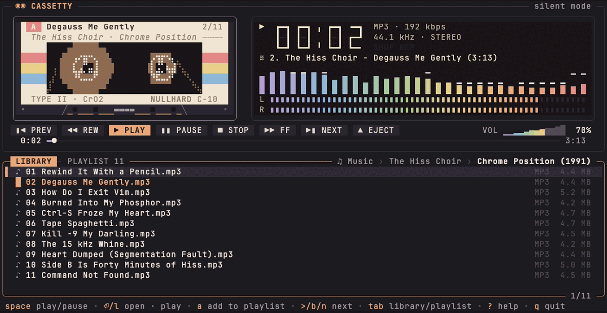
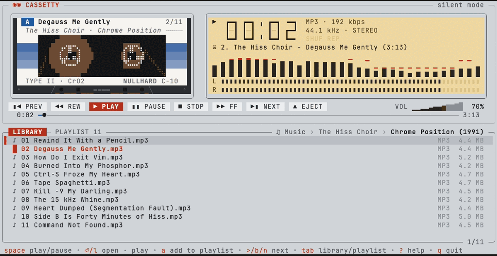
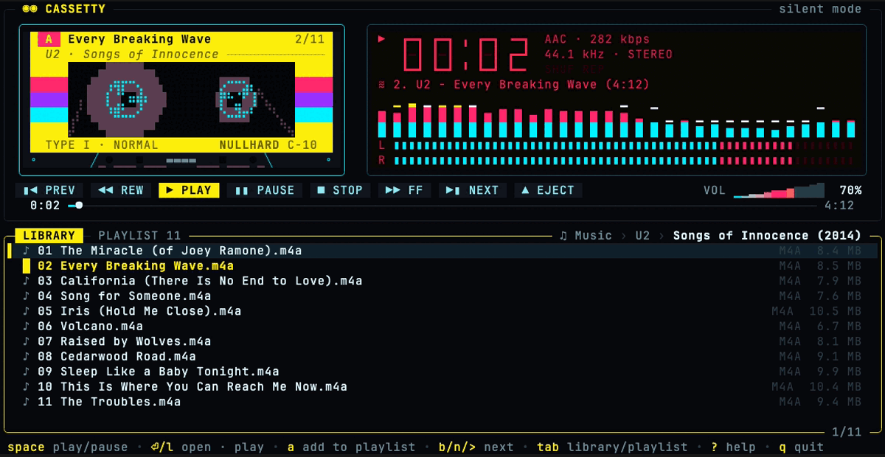
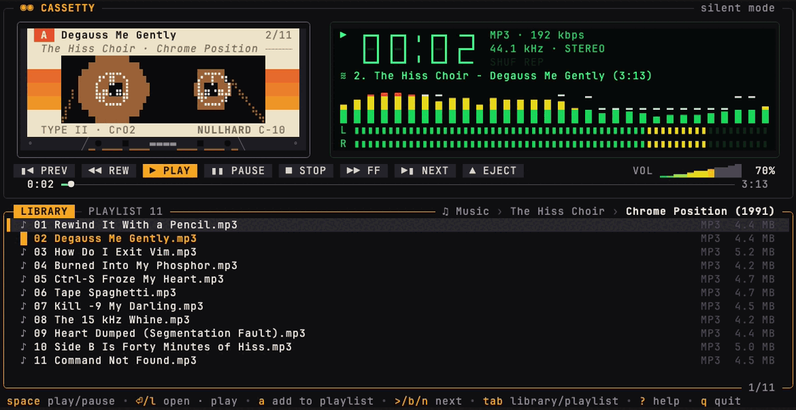
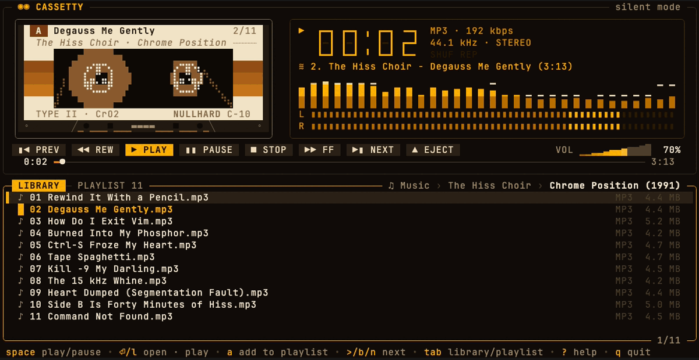
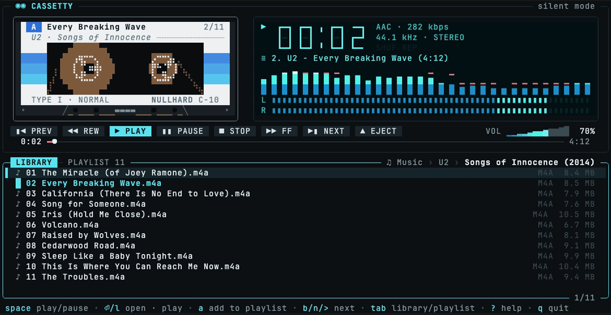
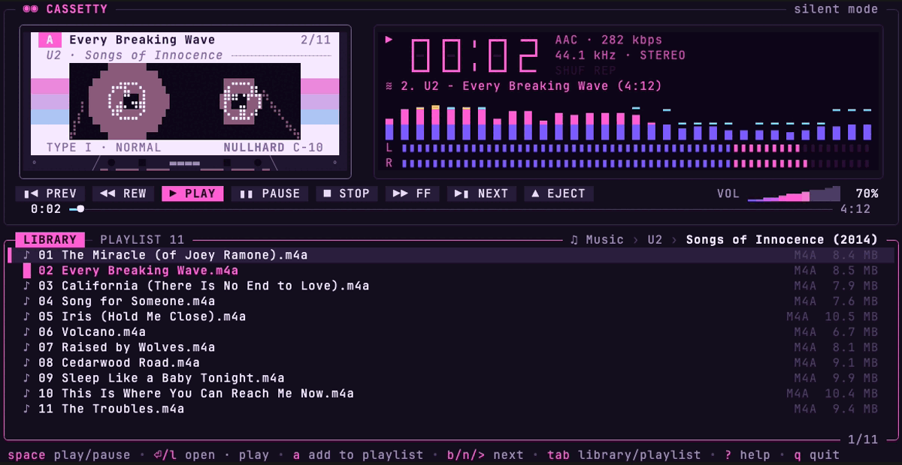

<p align="center">
  
</p>

<p align="center">
  <a href="https://github.com/nullhard/cassetty/releases/latest"></a>
  
  
  <a href="LICENSE"></a>
  <a href="https://github.com/nullhard/cassetty/actions/workflows/ci.yml"></a>
</p>

<p align="center">
  <b><a href="https://cassetty.io">Website</a></b> ·
  <a href="#install">Install</a> ·
  <a href="#usage">Usage</a> ·
  <a href="#keys">Keys</a> ·
  <a href="#skins">Skins</a> ·
  <a href="#configuration">Configuration</a>
</p>

<p align="center">
  
</p>

A cassette deck music player for your terminal.

Built with [Bubble Tea v2](https://github.com/charmbracelet/bubbletea),
[Lip Gloss](https://github.com/charmbracelet/lipgloss) and
[beep](https://github.com/gopxl/beep). Runs on macOS and Linux, controlled by
keyboard and mouse.

## Install

### Download

Grab the archive for your machine from the
[latest release](https://github.com/nullhard/cassetty/releases/latest), unpack
it and put `cassetty` somewhere on your `PATH`:

| | Apple Silicon · ARM64 | Intel · x86-64 |
|---|---|---|
| **macOS** | [cassetty_darwin_arm64.tar.gz](https://github.com/nullhard/cassetty/releases/latest/download/cassetty_darwin_arm64.tar.gz) | [cassetty_darwin_amd64.tar.gz](https://github.com/nullhard/cassetty/releases/latest/download/cassetty_darwin_amd64.tar.gz) |
| **Linux** | [cassetty_linux_arm64.tar.gz](https://github.com/nullhard/cassetty/releases/latest/download/cassetty_linux_arm64.tar.gz) | [cassetty_linux_amd64.tar.gz](https://github.com/nullhard/cassetty/releases/latest/download/cassetty_linux_amd64.tar.gz) |

Or pick the right one from a shell:

```sh
curl -fsSL https://github.com/nullhard/cassetty/releases/latest/download/cassetty_$(uname -s | tr A-Z a-z)_$(uname -m | sed 's/x86_64/amd64/;s/aarch64/arm64/').tar.gz | tar xz cassetty
sudo mv cassetty /usr/local/bin/
```

> [!NOTE]
> The macOS binaries are not notarized. If you downloaded the archive with a
> browser, clear the quarantine flag once:
> `xattr -d com.apple.quarantine cassetty`

### With Go

Requires Go 1.26 or newer.

```sh
go install github.com/nullhard/cassetty@latest
# or from a checkout
go build -o cassetty . && ./cassetty ~/Music
```

No cgo is required, so cross compiling is a plain
`GOOS=linux GOARCH=arm64 go build`.

**Linux:** audio goes through PulseAudio (also PipeWire's pulse server) and
falls back to ALSA (`libasound.so.2`, loaded at runtime). Without a usable
sound device cassetty starts in silent mode and tells you so.

## Formats

Decoded natively, no external tools needed: **MP3, FLAC, WAV, Ogg Vorbis**.

If [`ffmpeg`](https://ffmpeg.org) is on your `PATH`, cassetty also plays
**M4A/AAC/ALAC, Opus, AIFF, WMA, APE, WavPack, MKA, AC3, CAF**, and Ogg files
that hold Opus or FLAC. Tracks are resampled to 44.1 kHz.

## Usage

```
cassetty [flags] [music folder]

  -dir string       music folder (overrides music_dir from the config)
  -theme string     sunbleached (default), classic, amber, vfd, synthwave, silverface, cyberdeck
  -config string    config file path
  -init-config      write a commented default config file and exit
  -silent           do not open the audio device
  -version          print the version
```

The folder argument wins over the config file; without either cassetty opens
`~/Music`, or the current folder if there is no `~/Music`. The browser never
leaves that root folder.

## Keys

| Playback | | Library | |
|---|---|---|---|
| `space` `p` | play / pause | `↑↓` `jk` | move (`pgup` `pgdn` `g` `G`) |
| `s` `v` | stop | `enter` `l` | open folder · play track |
| `<` `>` | previous · next (`z` `b` `n`) | `backspace` `h` | parent folder |
| `←` `→` | seek 5 s | `~` | library root |
| `shift+←` `shift+→` | seek 30 s (`[` `]`) | `a` | add to playlist |
| `+` `-` | volume | `A` | play, replacing playlist |
| `m` | mute | `/` | filter, `esc` clears |
| `e` | eject | `f` | find the playing track |

| Playlist | | Modes | |
|---|---|---|---|
| `tab` `1` `2` | library · playlist | `S` | shuffle |
| `enter` | play selected | `r` | repeat off · all · one |
| `d` `x` | remove | `i` | elapsed · remaining |
| `c` | clear all | `t` | next theme |
| `K` `J` | move up / down | `?` | all keys |
| | | `q` | quit |

## Skins

Press `t` to cycle, pass `-theme`, or set `theme` in the config.

<table>
  <tr>
    <td width="50%"><br><b>sunbleached</b> · faded rainbow (default)</td>
    <td width="50%"><br><b>silverface</b> · brushed aluminium hi-fi</td>
  </tr>
  <tr>
    <td><br><b>cyberdeck</b> · yellow, magenta and cyan on black</td>
    <td><br><b>classic</b> · green LCD</td>
  </tr>
  <tr>
    <td><br><b>amber</b> · amber monochrome</td>
    <td><br><b>vfd</b> · cyan vacuum fluorescent display</td>
  </tr>
  <tr>
    <td><br><b>synthwave</b> · neon pink and blue</td>
    <td></td>
  </tr>
</table>

## Configuration

`~/.config/cassetty/config.toml` (or `$XDG_CONFIG_HOME/cassetty/config.toml`,
or `$CASSETTY_CONFIG`). Create a commented one with `cassetty -init-config`:

```toml
music_dir = "~/Music"      # root of the library (unset: ~/Music, else the current folder)
# themes: sunbleached, classic, amber, vfd, synthwave, silverface, cyberdeck
theme = "sunbleached"      # always start in this theme (unset: the last one used)
volume = 70                # initial volume in percent
show_hidden = false        # list dot files and folders
paint_background = true    # paint the terminal background in the theme color (silverface always does)
seek_step = 5              # seconds for ←/→ (shift = 6x)
```

Remembered state lives in `~/.local/state/cassetty/state.json`.

## Development

```sh
go test ./...
# open every file of a real library, and render reports
CASSETTY_TEST_MUSIC=~/Music go test ./internal/audio ./internal/ui -v
# exercise the sound device (at zero volume)
CASSETTY_TEST_DEVICE=1 go test ./internal/audio -run TestDevice
# write cassette renderings to a file for eyeballing
CASSETTY_PREVIEW=/tmp/cassette.ans go test ./internal/ui -run TestCassettePreview && cat /tmp/cassette.ans
```

Layout: `internal/audio` (decoding, the always-running deck streamer, oto
output, sample tap), `internal/viz` (FFT spectrum and VU ballistics),
`internal/library` (folder listing, natural sort, recursive collection,
tags), `internal/watch` (watches the shown folder with one kqueue/inotify
handle; no per-file descriptors), `internal/ui` (Bubble Tea model;
`cassette.go`, `lcd.go`, `controls.go`, `browser.go` render the parts,
`live.go` keeps the shown folder current), `internal/config`.

**Website and demos.** `docs/` is the GitHub Pages site, deployed by
`.github/workflows/pages.yml`; its skin colors come from
`internal/ui/theme.go`. `scripts/demo/record.sh` re-records the videos,
screenshots and `demo.gif` in `docs/media` with
[vhs](https://github.com/charmbracelet/vhs), playing a generated library.

**Releases.** The Release workflow (`.github/workflows/release.yml`) is
started by hand. It runs the tests, lets [git-cliff](https://git-cliff.org)
pick the next version from the
[Conventional Commits](https://www.conventionalcommits.org) since the last
tag (or applies the bump you choose), builds the macOS and Linux archives for
amd64 and arm64, then tags the commit and publishes a GitHub release with
notes, checksums and build provenance. A dry run builds everything without
publishing.

```sh
gh workflow run release.yml -f bump=auto -f dry_run=true
# the same archives, locally
scripts/release-build.sh v0.0.0-dev dist
```

## License

Copyright 2026 Samuel Barabas. Licensed under the [Apache License, Version 2.0](LICENSE); see also [NOTICE](NOTICE).
